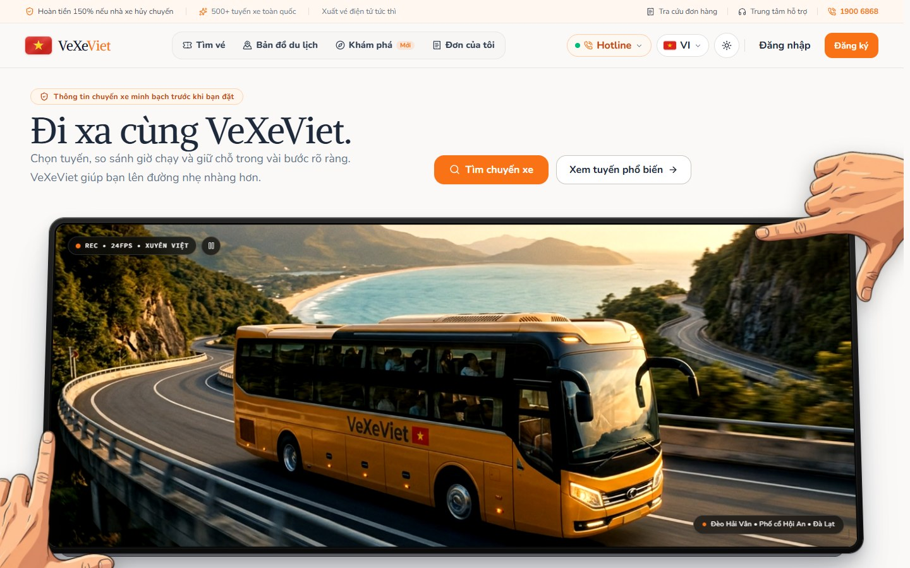
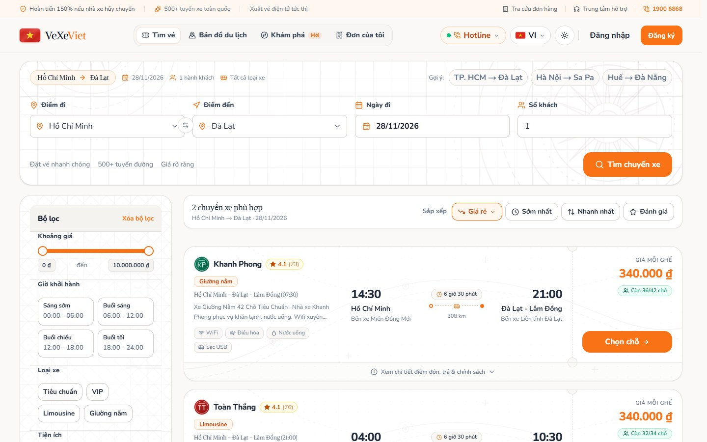
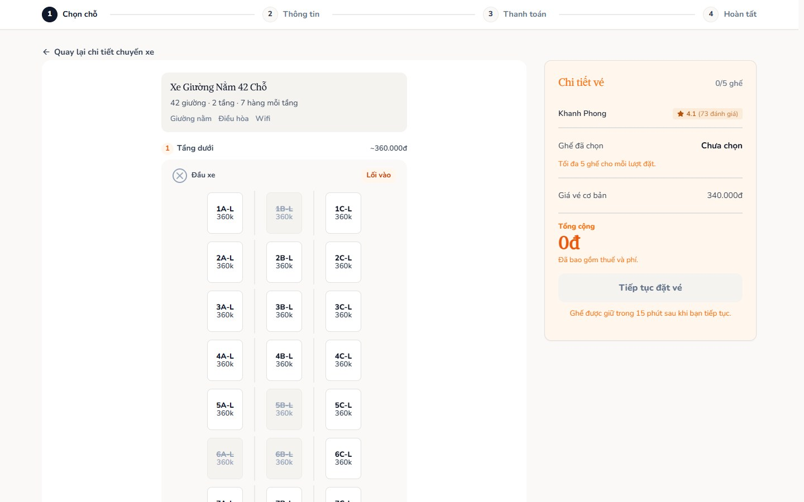
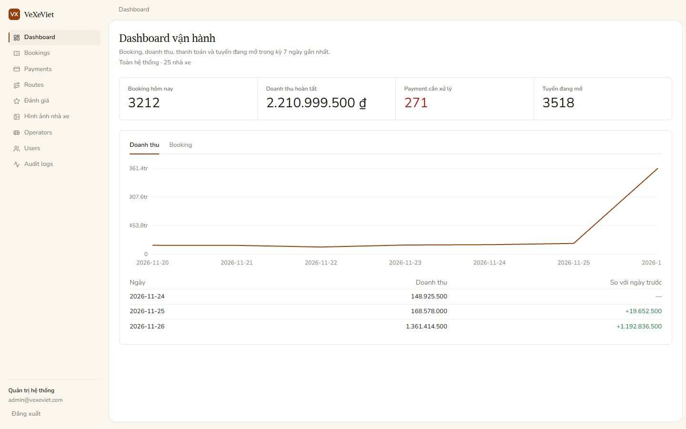
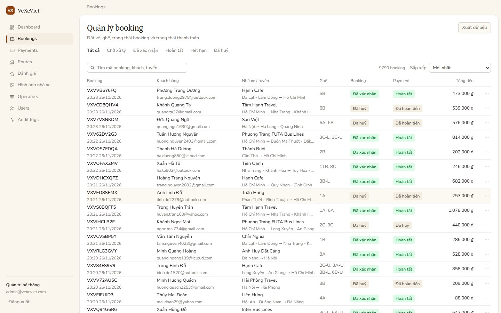
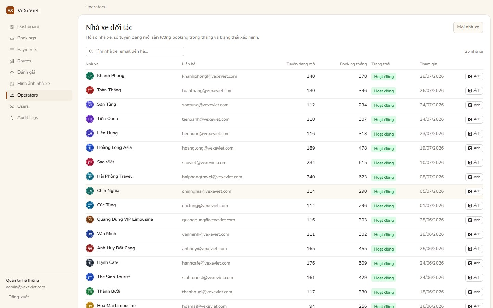

# VeXeViet Frontend (`vexeviet-fe`)

Kho mã nguồn Frontend Turborepo cho nền tảng đặt vé xe khách liên tỉnh **VeXeViet**, bao gồm hai ứng dụng độc lập chạy trên Next.js 14 App Router: ứng dụng đặt vé cho hành khách (`apps/web`) và cổng vận hành dành cho quản trị viên cùng đối tác nhà xe (`apps/admin`).

## Liên kết hệ thống Demo trực tuyến

| Phân hệ | Đường dẫn truy cập | Hạ tầng triển khai |
| :--- | :--- | :--- |
| **Ứng dụng Đặt vé hành khách (`apps/web`)** | https://vexeviet-web.vercel.app | Vercel Edge Network |
| **Cổng Quản trị & Nhà xe (`apps/admin`)** | https://vexeviet-admin.vercel.app | Vercel Edge Network |
| **Cổng Backend API Gateway (`vexeviet-be`)** | https://vexeviet-api-8752.onrender.com | Render Docker Container |
| **Tài liệu OpenAPI 3.0 (Swagger UI)** | https://vexeviet-api-8752.onrender.com/api/docs | Express + Swagger UI |

### Tài khoản dùng thử trên bản Demo

| Vai trò | Email đăng nhập | Mật khẩu | Phân hệ sử dụng |
| :--- | :--- | :--- | :--- |
| **Quản trị hệ thống (`ADMIN`)** | `admin@vexeviet.com` | `Admin@123456` | Cổng Quản trị (`apps/admin`) |
| **Đối tác Nhà xe (`OPERATOR`)** | `phuongtrang@vexeviet.com` | `Password@123` | Cổng Quản trị (`apps/admin`) |
| **Hành khách (`CUSTOMER`)** | `customer@vexeviet.com` | `Password@123` | Ứng dụng Đặt vé (`apps/web`) |

---

## Hình ảnh giao diện hệ thống

### 1. Ứng dụng Đặt vé hành khách (`apps/web`)

**Trang chủ tra cứu tuyến xe liên tỉnh**


**Tìm kiếm, lọc chuyến xe và xem thông tin nhà xe**


**Chi tiết hành trình và sơ đồ chọn ghế theo thời gian thực**


### 2. Cổng Điều hành Quản trị & Nhà xe (`apps/admin`)

**Bảng điều khiển thống kê doanh thu và sản lượng đặt vé**


**Quản lý danh sách đặt vé và trạng thái thanh toán**


**Quản lý hồ sơ và hình ảnh của 25 đối tác nhà xe**


---

## Tính năng chính theo phân hệ

### Ứng dụng Hành khách (`apps/web`)
- **Tìm kiếm và lọc chuyến**: Tra cứu hành trình giữa 63 tỉnh thành, lọc theo khung giờ xuất bến, mức giá, tiện ích trên xe và loại phương tiện (`SLEEPER`, `LIMOUSINE`, `VIP`, `STANDARD`).
- **Sơ đồ ghế chuyên biệt theo dòng xe**: Tự động nhận diện và hiển thị đúng bố cục vật lý của 7 mẫu xe thực tế (`SLEEPER_42`, `SLEEPER_34`, `LIMOUSINE_20`, `LIMOUSINE_22`, `LIMOUSINE_34`, `VIP_29`, `STANDARD_45`).
- **Giữ chỗ tạm thời và thanh toán**: Khoá ghế có thời hạn khi bước vào luồng thanh toán, chọn điểm đón/trả chi tiết, tích hợp cổng VNPay cùng tra cứu mã đặt chỗ `VXV...` không cần đăng nhập.
- **Đánh giá sau chuyến đi**: Gửi điểm sao và nhận xét cho các chuyến đã hoàn thành, xem phản hồi trực tiếp từ nhà xe.

### Cổng Quản trị & Nhà xe (`apps/admin`)
- **Phân quyền tách biệt (`ADMIN` / `OPERATOR`)**: Quản trị viên giám sát toàn bộ 25 nhà xe; tài khoản nhà xe chỉ xem và thao tác trên tuyến đường, đơn đặt vé, doanh thu và đánh giá thuộc đơn vị mình.
- **Vận hành đơn vé và đối soát thanh toán**: Lọc đơn theo trạng thái vé hoặc trạng thái giao dịch mới nhất, xác nhận hoặc huỷ vé hàng loạt, rà soát các giao dịch lệch trạng thái (`Reconciliation`) và đồng bộ lại đơn vé.
- **Quản lý hình ảnh nhà xe trên Cloudinary**: Tải lên, thay thế và xoá ảnh đại diện thương hiệu, ảnh nội thất và ảnh ngoại thất đội xe trực tiếp lên CDN.
- **Nhật ký kiểm toán (`Audit Logs`)**: Ghi nhận chi tiết người thực hiện, hành động và đối tượng tác động trên các thao tác nhạy cảm.

---

## Cấu trúc thư mục Monorepo

```text
vexeviet-fe/
├── apps/
│   ├── web/              # (:8081) Ứng dụng đặt vé dành cho hành khách (Next.js 14 App Router)
│   └── admin/            # (:8082) Cổng điều hành cho ADMIN & OPERATOR (Next.js 14 App Router)
├── packages/
│   ├── types/            # (@vexeviet/types) Định nghĩa kiểu dữ liệu và hợp đồng API dùng chung
│   ├── api-client/       # (@vexeviet/api-client) Đường dẫn endpoint, chuẩn hoá lỗi, X-Request-Id, xử lý URL ảnh
│   ├── ui/               # (@vexeviet/ui) Thành phần giao diện cơ sở và tiện ích ghép lớp CSS
│   └── config/           # (@vexeviet/config) Cấu hình TypeScript và ESLint dùng chung
├── docs/
│   ├── screenshots/      # Ảnh chụp màn hình giao diện thực tế phục vụ tài liệu
│   └── ...               # Tài liệu thiết kế, hướng dẫn tích hợp và kiểm thử
└── archive/
    └── mobile/           # Bản thử nghiệm Expo/React Native (tách khỏi luồng build mặc định)
```

---

## Khởi chạy môi trường phát triển (`Local Dev`)

### Yêu cầu công cụ
- `Node.js >= 20.0.0`
- `pnpm >= 8.0.0`

### Các bước cài đặt

```bash
pnpm install
cp .env.example .env.local
```

Khai báo biến môi trường trong `.env.local` (hoặc tệp `.env.local` riêng của từng ứng dụng):

```env
NEXT_PUBLIC_API_URL=http://localhost:3000
GEMINI_API_KEY=<khoa-api-google-gemini-tuy-chon>
```

Chạy ứng dụng ở chế độ phát triển:

```bash
pnpm dev          # Chạy song song cả web (:8081) và admin (:8082)
pnpm dev:web      # Chỉ chạy ứng dụng khách hàng tại http://localhost:8081
pnpm dev:admin    # Chỉ chạy cổng quản trị tại http://localhost:8082
```

### Kiểm tra chất lượng mã nguồn

```bash
pnpm typecheck    # Kiểm tra kiểu TypeScript trên toàn bộ workspace
pnpm lint         # Kiểm tra quy tắc ESLint
pnpm test:unit    # Chạy bộ kiểm thử đơn vị (Vitest)
pnpm build        # Biên dịch bản production cho toàn bộ packages và apps
```
